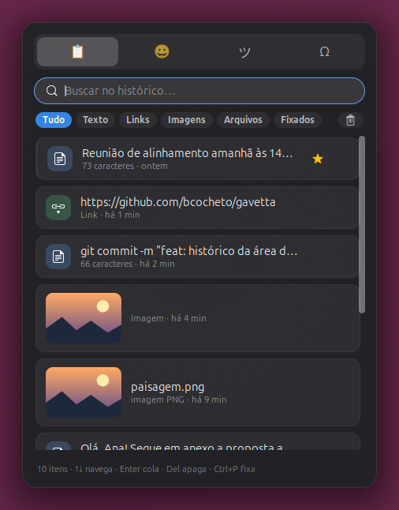
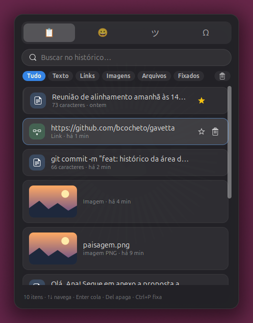
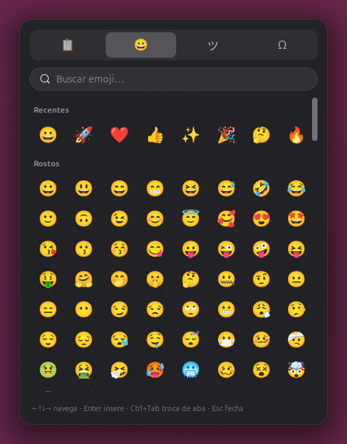
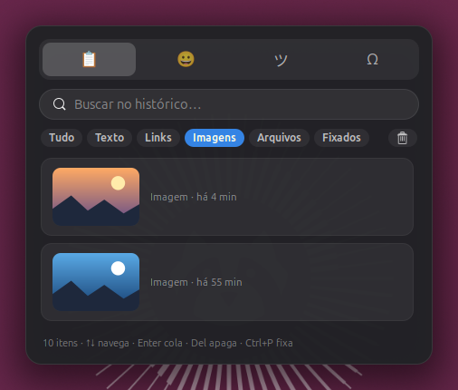
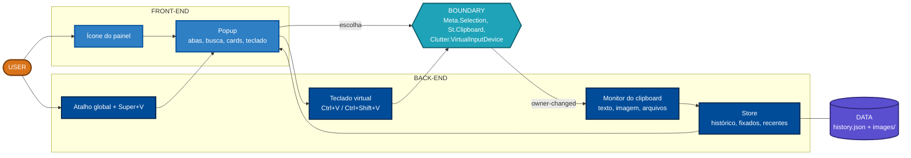

<div align="center">

# 🗄️ Gavetta

**O `Win + V` do Windows, feito para o GNOME Shell.**
Histórico da área de transferência com texto, links, imagens, arquivos e vídeos, mais emoji, kaomoji e símbolos, tudo num popup que abre com `Super + V`.


</div>

---

## 📸 Capturas

<table>
  <tr>
    <td align="center"><br><sub>Histórico com prévias e itens fixados</sub></td>
    <td align="center"><br><sub>Navegação por teclado, com fixar e apagar</sub></td>
  </tr>
  <tr>
    <td align="center"><br><sub>Emoji com recentes e categorias</sub></td>
    <td align="center"><br><sub>Filtros por tipo (aqui, só imagens)</sub></td>
  </tr>
</table>

## ✨ Funcionalidades

| | Recurso | Detalhe |
|---|---|---|
| 📋 | **Histórico da área de transferência** | Texto, links, imagens, arquivos e vídeos copiados no gerenciador de arquivos |
| 🖼️ | **Prévias** | Miniatura de imagens e arquivos (usa as miniaturas do próprio GNOME), domínio nos links, contagem de caracteres no texto |
| 📌 | **Fixar** | Itens fixados ficam no topo e nunca saem do histórico |
| 🔍 | **Busca instantânea** | Comece a digitar assim que o popup abrir; filtros por tipo (Texto, Links, Imagens, Arquivos, Fixados) |
| 😀 | **Emoji, kaomoji e símbolos** | ~450 emojis em 7 categorias com busca em português, além de recentes |
| ⌨️ | **Tudo pelo teclado** | Setas navegam, `Enter` cola, `Del` apaga, `Ctrl+P` fixa, `Ctrl+Tab` troca de aba |
| 📍 | **Abre onde você está** | Perto do ponteiro (padrão), no centro da janela ativa ou no centro da tela |
| 🖱️ | **Cola direto** | Escolheu? A Gavetta envia `Ctrl+V` para o app (ou `Ctrl+Shift+V` em terminais) |
| 🔐 | **Respeita senhas** | Ignora o que gerenciadores de senha marcam como sensível (KeePassXC, Bitwarden etc.) |
| ⚙️ | **Preferências** | Tamanho do histórico, atalho, posição do popup, ícone no painel |

### Comparação com o Win + V

| Win + V (Windows 11) | Gavetta |
|---|---|
| Atalho `Win + V` | `Super + V` (a extensão assume o atalho) |
| Abas: área de transferência, emoji, GIFs, kaomoji, símbolos | Área de transferência, emoji, kaomoji, símbolos |
| Fixar e apagar itens, limpar tudo | ✅ |
| Popup perto de onde você digita | Perto do ponteiro, janela ou tela (o GNOME não expõe a posição do cursor de texto no Wayland) |
| Histórico sincronizado entre dispositivos | ❌ Local de propósito: nada sai da sua máquina |
| Aba de GIFs (Tenor) | ❌ Exigiria acesso à rede |

## 📦 Instalação

> Requer **GNOME Shell 50**.

### A partir do código-fonte

```bash
git clone https://github.com/bcocheto/gavetta.git
cd gavetta
make install
```

No Wayland, saia da sessão e entre de novo para o GNOME enxergar a extensão. Depois:

```bash
gnome-extensions enable gavetta@bcocheto.github.io
```

Quer testar sem sair da sessão? Instale o `mutter-dev-bin` e rode um shell aninhado:

```bash
sudo apt install mutter-dev-bin
make run
```

## ⌨️ Atalhos

| Tecla | Ação |
|---|---|
| `Super + V` | Abre ou fecha a Gavetta |
| `↑ ↓ ← →` | Navega entre os itens |
| `Enter` | Cola o item selecionado (ou o primeiro, se você estiver na busca) |
| `Del` | Apaga o item |
| `Ctrl + P` | Fixa ou desafixa o item |
| `Ctrl + Tab` / `Ctrl + 1…4` | Troca de aba |
| `Esc` | Fecha |

### Sobre o `Super + V`

No GNOME, `Super + V` abre a bandeja de notificações. Enquanto a Gavetta estiver ativa, ela **remove só essa combinação** de `org.gnome.shell.keybindings toggle-message-tray` (a bandeja continua em `Super + M`) e **restaura o valor original ao desativar**. O backup fica nas configurações da própria extensão, então sobrevive a um travamento do shell. Se preferir outro atalho, desligue "Assumir o Super+V" nas preferências e troque o atalho.

## 🧱 Arquitetura

Modelo em MDL 2.0 (aproximado em Mermaid).



| Arquivo | Papel |
|---|---|
| [`extension.js`](gavetta@bcocheto.github.io/extension.js) | Ciclo de vida, monitor do clipboard, atalho, colar |
| [`popup.js`](gavetta@bcocheto.github.io/popup.js) | Interface do popup (abas, cards, grade de emoji, teclado) |
| [`store.js`](gavetta@bcocheto.github.io/store.js) | Histórico em disco (JSON + imagens PNG) |
| [`data.js`](gavetta@bcocheto.github.io/data.js) | Emoji, kaomoji e símbolos com palavras-chave em pt-BR |
| [`prefs.js`](gavetta@bcocheto.github.io/prefs.js) | Janela de preferências (libadwaita) |
| [`stylesheet.css`](gavetta@bcocheto.github.io/stylesheet.css) | Visual do popup |

## 🔒 Privacidade

- Tudo fica em `~/.local/share/gavetta/` (`history.json` e `images/`). Nada é enviado pela rede.
- Conteúdo marcado como sensível por gerenciadores de senha (`x-kde-passwordManagerHint`) **não é gravado**.
- Para esquecer tudo: botão **Limpar** no popup (mantém fixados) ou apague a pasta acima.

## 🛠️ Desenvolvimento

```bash
make lint      # checa a sintaxe dos .js e do schema
make install   # compila o schema e copia para ~/.local/share/gnome-shell/extensions
make run       # shell aninhado (precisa do mutter-dev-bin)
make pack      # gera dist/gavetta@bcocheto.github.io.shell-extension.zip
```

Logs do shell:

```bash
journalctl -f -o cat /usr/bin/gnome-shell
```

## 🗺️ Roadmap

- [ ] GIF de demonstração
- [ ] Publicar no extensions.gnome.org
- [ ] Ignorar apps específicos (lista configurável)
- [ ] Colar como texto simples
- [ ] Mais emojis (conjunto Unicode completo) e tons de pele
- [ ] Snippets (textos fixos reutilizáveis)
- [ ] Tradução (en)

## 🤝 Contribuindo

Issues e PRs são bem-vindos. Antes de abrir um PR, rode `make lint` e teste no shell aninhado (`make run`).

## 📄 Licença

[GPL-3.0-or-later](LICENSE).
